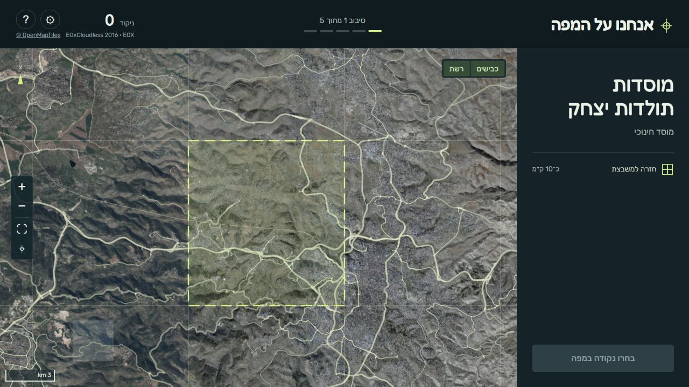

<div align="center">
  
  <h1>אנחנו על המפה</h1>
  <p>A Hebrew geography game. A place name, a square, and your best guess.</p>
  <p><a href="LICENSE">MIT code</a> · <a href="THIRD_PARTY_NOTICES.md">Data & credits</a> · <a href="CONTRIBUTING.md">Contribute</a></p>
</div>



Find real places on aerial imagery without map labels. Each round reveals a name, a category and its geographic square. Place a pin on land inside that square; the closer you get, the more points you earn.

## Play locally

Requires **Node.js 24+**, including its built-in SQLite module. No accounts, API keys or package installation are needed.

```sh
npm start
```

Open **http://127.0.0.1:4173**. Imagery and roads load from public tile services, so playing requires an internet connection. Fonts and the map engine are bundled locally.

The local Node server serves the app and its game API. It saves browser identities, games and attempts in **`.data/satguess.sqlite`**, created on first use and ignored by Git. Records survive server restarts. An HttpOnly browser cookie identifies your local player; a generated nickname can be replaced with an optional 2–24-character nickname. History follows that browser identity, so another browser or device has separate history.

## The game

- **Practice:** five untimed rounds, up to 100 points each; choose a difficulty and place collection.
- **Daily challenge:** the same five places for everyone, with **30 seconds per round** and one attempt per browser identity each calendar day in **Asia/Jerusalem**.
- Hebrew interface with right-to-left layout.
- Approximate 5, 10 or 20 km grid squares.
- Two place collections: landmarks/institutions, or the broader collection including local businesses.
- A red 10 m circle reveals practice answers after each guess. Daily answers remain hidden until the five-round challenge is complete.
- Personal bests stay in your browser, separately for each collection and difficulty.
- The server owns scores and daily deadlines. Refreshing or resuming a game keeps the original clock; the last saved valid pin is used when time expires, and no saved pin earns zero.
- After completing a daily challenge, view its leaderboard, your rank and the distribution of total scores.

Practice comparisons can appear after each committed guess; daily comparisons unlock after the full challenge. A percentile requires at least **30 comparable first-exposure attempts from other browser identities**. Lower distance is better; equal distances do not count as worse guesses. Practice and timed daily attempts use separate comparison cohorts. Small samples remain in a warm-up state.

At the default 10 km setting, the snapshot offers **14,560** landmarks/institutions or **25,164** places including businesses. Ambiguous names and tagged chain branches within a square are excluded for that difficulty. No city qualifier is added to the prompt.

The playable area includes Israel proper, the Golan Heights and the West Bank. Gaza, neighbouring countries and surrounding sea are masked out. A guess must be inside both the active square and the playable land area.

## Development

The frontend uses HTML, CSS and JavaScript modules. `server.mjs` starts the local HTTP API and SQLite-backed game service using Node built-ins. Run the app through `npm start` so the browser and API share the same origin and cookie. This setup is for local use; no hosting or deployment is configured.

```sh
npm test
npm run check
```

| Directory | Contents |
| --- | --- |
| `dist/` | Playable app, question snapshot, fonts and map engine |
| `server/` | Game rules/service, catalog, HTTP API, SQLite storage and schema |
| `data/` | Source provenance, boundary geometry, query and seed places |
| `scripts/` | Place-data maintenance, syntax checks and attempt CSV export |
| `tests/` | Geography, scoring, lifecycle/timers, storage, API and data checks |
| `licenses/` | Third-party license texts and attribution guidance |

## Places and imagery

OpenStreetMap is the main place source; Wikidata contributes additional landmarks. The app loads a saved snapshot and does not query those services during a round. To refresh the list, run the offline tools described in [the data guide](docs/DATA.md).

The same guide documents the local attempt database and its CSV export. For example:

```sh
npm run export:attempts -- --output outputs/attempts.csv --finalized-only --first-exposure-only
```

The exporter reads normalized attempt measurements and omits player/run/attempt IDs, nicknames, session credentials and raw JSON. Its output includes timestamps and guess coordinates. An explicit output path is required, and an existing file is never overwritten.

Targets are source-screened, not individually surveyed. Some coordinates represent a building or area's centre rather than its entrance; the 10 m answer circle does not guarantee 10 m source accuracy. Names, venues and imagery may differ in age. Report a questionable target with its source link.

The main aerial imagery is the **Survey of Israel 2015 orthophoto**. EOX's **2016** mosaic fills confirmed gaps only within the playable area. Roads use OpenStreetMap geometry through OpenFreeMap/OpenMapTiles. Full sources, licenses and required credits are available from `?` in the game and in [third-party notices](THIRD_PARTY_NOTICES.md).

## License

Original application code is **[MIT](LICENSE)**. MapLibre, fonts, map data and imagery retain their own open licenses. The adapted place database is **ODbL 1.0**; Wikidata source records are **CC0**. See [the notices](THIRD_PARTY_NOTICES.md) before redistributing those materials.

Preview imagery: Survey of Israel; EOxCloudless by EOX IT Services GmbH, containing modified Copernicus Sentinel data 2016. Roads and boundaries: © OpenStreetMap contributors, OpenMapTiles and geoBoundaries. Their applicable credits and licenses are retained in the source notices.
